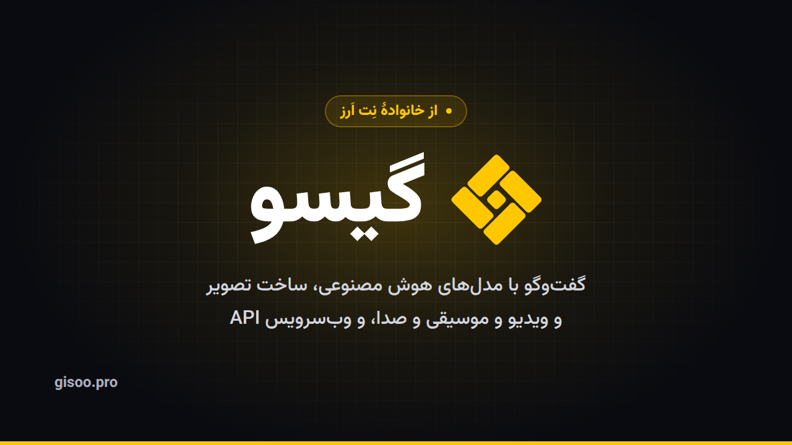

<div align="center">

<a href="https://gisoo.pro/?utm_source=github&utm_medium=referral&utm_campaign=gisoo&utm_content=header"></a>

# گیسو (Gisoo)

**اپ و وب‌سرویس هوش مصنوعی به زبان فارسی؛ برند هوش مصنوعی نِت اَرز.**

Gisoo is a Persian AI app and an OpenAI- and Anthropic-compatible API: 400+ models, one key.

[][site]
[][docs]
[][quickstart]
[][anthropic]
[](https://github.com/netarz/gisoo/actions/workflows/ci.yml)
[](LICENSE)

[معرفی گیسو][about] · [اپ گیسو][app] · [وب‌سرویس][api] · [مستندات][docs] · [آموزش‌های ویدیویی][tutorials] · [English](#english)

</div>

<a id="intro"></a>

## گیسو چیست

گیسو دختر باهوش قصهٔ ماست. هر تار مویش به یکی از سرویس‌دهنده‌ها و مدل‌های هوش مصنوعی وصل است و این تارها در یک
رابط ساده و فارسی به هم می‌رسند. نتیجه یک اپ برای کار روزمره با هوش مصنوعی و یک وب‌سرویس (API) برای برنامه‌نویس‌هاست:
بیش از ۴۰۰ مدل از حدود ۵۰ سازنده، مثل GPT، Claude، Gemini، DeepSeek، Grok، Llama و Qwen، با یک حساب و یک اعتبار.

کارت ارزی و فیلترشکن لازم نیست. اشتراک ماهانه هم ندارد: هر قدر شارژ کنید، همان‌قدر مصرف می‌کنید. گیسو برند هوش مصنوعی
نِت اَرز است و حساب کاربری، کیف پول، اعتبار، تیکت و احراز هویت در هر دو سایت یکی است.

## فهرست

- [امکانات اپ گیسو](#app)
- [وب‌سرویس گیسو](#api)
- [Claude Code با گیسو](#claude-code)
- [نمونه‌کدهای این مخزن](#examples)
- [گیسو و نِت اَرز](#netarz)
- [مشارکت و پشتیبانی](#support)
- [English](#english)

<a id="app"></a>

## امکانات اپ گیسو

اپ گیسو در [gisoo.pro/app][app] است و روی گوشی و کامپیوتر از خود مرورگر نصب می‌شود (PWA).

| بخش | چه می‌کند |
|---|---|
| **دستیار «گیسو»** | برای هر پیام خودش مدل مناسب را انتخاب می‌کند (کد، نوشتن، تحلیل، عکس، متن بلند) و زیر جواب می‌نویسد کدام مدل پاسخ داده. هزینه همان قیمت مدلی است که جواب داده، بدون هزینهٔ اضافه. |
| **[گفت‌وگو با هر مدل][chat]** | عکس، PDF، Word و Excel را می‌خواند، لینک را باز می‌کند، در وب جست‌وجو می‌کند و منبع را می‌گوید. حافظه دارد و از هر گفت‌وگو می‌شود خروجی گرفت. |
| **[کارشناس‌ها][experts]** | ۲۲ دستیار متخصص در پنج حوزه: حقوقی (عریضه‌نویس، قراردادنویس…)، پزشکی و سلامت، مالی و مالیات، کسب‌وکار و بازاریابی، کار و تحصیل و مهاجرت. متن آماده (نامه، دادخواست، قرارداد) را Word یا PDF می‌دهند. کارشناس‌ها هوش مصنوعی‌اند، نه وکیل یا پزشک؛ متن را پیش از ثبت یا امضا به متخصص نشان دهید. |
| **گفت‌وگوی صوتی زنده** | با «صدای گیسو» مثل یک تماس صوتی حرف می‌زنید؛ وسط حرفش می‌شود حرف زد و زیرنویس زنده دارد. |
| **[ساخت تصویر][image]** | از روی توضیح فارسی، با GPT Image و Nano Banana؛ لوگو، پوستر، بنر و عکس محصول. تا سه عکس خودتان را هم می‌گذارید و عکس فروشگاهی یا صحنهٔ تبلیغاتی می‌گیرید. |
| **[ساخت ویدیو][video]** | کلیپ کوتاه با Veo 3.1 و Sora 2، از روی متن یا از روی یک عکس. هزینهٔ ساخت ناموفق خودکار برمی‌گردد. |
| **[ساخت موسیقی][music]** | قطعهٔ بی‌کلام یا آهنگ با کلام با Lyria؛ پس‌زمینهٔ پادکست، جینگل و تیزر. |
| **[تبدیل متن به صدا][voice]** و **[صدا به متن][stt]** | نریشن، آگهی و تلفن گویا با صدای Gemini و OpenAI؛ ویس، جلسه و کلاس به متن، با جدا کردن گوینده‌ها یا زیرنویس SRT. |
| **[کتابخانهٔ پرامپت][prompts]** | ۱۷۰ قالب آماده برای عکس، ویدیو، موسیقی، صدا و نوشتن، بیشترشان با نمونهٔ واقعی که مدل با همان متن ساخته. |
| **[کتابخانهٔ مدل‌ها][models]** | همهٔ مدل‌ها با قیمت، مقایسهٔ نسخه‌های یک خانواده و صفحهٔ هر سازنده. |

برای هر کار یک فیلم کوتاه هم داریم: [آموزش‌های ویدیویی گیسو][tutorials].

<a id="api"></a>

## وب‌سرویس گیسو

یک نشانی، یک کلید، و همهٔ مدل‌ها. کدی که برای OpenAI نوشته‌اید با عوض کردن دو مقدار کار می‌کند:

| مقدار | در OpenAI | در گیسو |
|---|---|---|
| نشانی پایه (base URL) | `https://api.openai.com/v1` | `https://gisoo.pro/api/v1` |
| کلید دسترسی (API Key) | `sk-proj-…` | `sk-gisoo-v1-…` |

```python
from openai import OpenAI

client = OpenAI(base_url="https://gisoo.pro/api/v1", api_key="sk-gisoo-v1-...")
r = client.chat.completions.create(model="gpt-4o-mini", messages=[{"role": "user", "content": "سلام"}], max_tokens=200)
print(r.choices[0].message.content)
```

- **مسیرها:** `/chat/completions`، `/responses`، `/embeddings`، `/images/generations`، `/audio/speech`،
  `/audio/transcriptions`، `/audio/music`، `/videos` (ساختن، پرسیدن وضعیت، دانلود)، `/models`، `/me` و `/usage`.
  پاسخ جریانی (streaming) هم کار می‌کند.
- **سازگار با Anthropic:** `POST /messages` همان Messages API شرکت Anthropic است؛ کتابخانهٔ رسمی Anthropic و Claude Code
  مستقیم به گیسو وصل می‌شوند.
- **فهرست مدل‌ها بدون کلید:** `curl "https://gisoo.pro/api/v1/models?type=chat"` (`type` می‌تواند `chat`، `image`،
  `video`، `music`، `audio_tts`، `audio_stt` یا `embedding` باشد).
- **کلید** را در [بخش API اپ][app-api] می‌سازید. برای هر کلید سقف هزینه و مدل‌های مجاز می‌گذارید. درخواستی که پیش از
  تولید جواب خطا بدهد هزینه ندارد.
- **ابزارها:** Cursor، Continue، Cline، n8n، LangChain، LlamaIndex، Dify و Open WebUI ([راهنمای یکپارچه‌سازی][integrations]).

[شروع سریع][quickstart] · [مرجع تعاملی API][reference] · [فایل OpenAPI](https://gisoo.pro/api/v1/openapi.json) · [پرسش‌های پرتکرار][faq]

<a id="claude-code"></a>

## Claude Code با گیسو

Claude Code را با کلید گیسو اجرا کنید. نشانی را **بدون** `/v1` بگذارید، چون Claude Code خودش `/v1/messages` را اضافه می‌کند:

```bash
export ANTHROPIC_BASE_URL="https://gisoo.pro/api"
export ANTHROPIC_AUTH_TOKEN="sk-gisoo-v1-..."
export ANTHROPIC_MODEL="claude-sonnet-5-5"
export ANTHROPIC_DEFAULT_HAIKU_MODEL="claude-haiku-4-5"
claude
```

برای این‌که همیشه همین تنظیم بماند، بخش `env` فایل [`claude-code/settings.json`](claude-code/settings.json) را در
`~/.claude/settings.json` بگذارید. افزونهٔ Claude Code در VS Code هم همین فایل را می‌خواند؛ فقط
`"claudeCode.disableLoginPrompt": true` را به تنظیمات VS Code اضافه کنید ([آموزش قدم‌به‌قدم][vscode]).

چند نکته: نام‌هایی مثل `claude-sonnet-5-5`، `claude-opus-5-5` و `claude-haiku-4-5` کار می‌کنند. «thinking» نادیده گرفته
می‌شود و ابزارهای سمت سرور Anthropic (جست‌وجوی وب و اجرای کد) از راه گیسو کار نمی‌کنند. Claude Code برای هر قدم مبلغی کنار
می‌گذارد، پس با اعتبار خیلی کم خطای `insufficient_credit` می‌گیرید. [راهنمای کامل][anthropic]

<a id="examples"></a>

## نمونه‌کدهای این مخزن

| پوشه | چه نشان می‌دهد |
|---|---|
| [`claude-code/`](claude-code/) | تنظیم Claude Code در bash، PowerShell، `settings.json` و VS Code |
| [`anthropic/`](anthropic/) | کتابخانهٔ رسمی Anthropic در Python و Node.js، استریم، و curl روی `/messages` |
| [`openai/`](openai/) | کتابخانهٔ رسمی OpenAI در Python و Node.js، استریم، و curl برای مدل‌ها، گفت‌وگو و موجودی |
| [`media/`](media/) | ساخت تصویر، ویدیو (کار غیرهم‌زمان)، موسیقی، متن به صدا و صدا به متن |

```bash
git clone https://github.com/netarz/gisoo.git && cd gisoo
export GISOO_API_KEY="sk-gisoo-v1-..."
pip install -r openai/requirements.txt && python openai/chat.py
```

نمونه‌های بیشتر به زبان‌های دیگر (PHP، Laravel، Go، C#، Ruby، LangChain و ربات تلگرام) در مخزن
[ai-api-examples](https://github.com/netarz/ai-api-examples) هستند؛ با گذاشتن `https://gisoo.pro/api/v1` به‌جای نشانی پایه،
همان کدها با کلید گیسو کار می‌کنند.

فهرست باز سرورهای MCP برای «فروشگاه MCP» اپ گیسو در مخزن [gisoo-mcp-registry](https://github.com/netarz/gisoo-mcp-registry) است؛ سرور تازه را با پول‌ریکوئست پیشنهاد دهید.

**کلید را روی سرور خودتان نگه دارید**، در متغیر محیطی یا فایل `.env` ([نمونه](.env.example))، نه در کد سمت مرورگر یا
اپ موبایل و نه در گیت.

<a id="netarz"></a>

## گیسو و نِت اَرز

گیسو برند هوش مصنوعی [نِت اَرز][netarz] است، نه شرکت یا سرویس دیگری. یک حساب در هر دو سایت کار می‌کند و اعتبار
هوش مصنوعی هم یکی است:

- کلید `sk-gisoo-v1-…` روی `https://netarz.ir/api/ai/v1` هم کار می‌کند و کلید `sk-ntz-v1-…` نِت اَرز روی
  `https://gisoo.pro/api/v1`. فقط مسیر Anthropic (`/messages` و Claude Code) مخصوص نشانی گیسو است.
- افزونه‌های [وردپرس](https://github.com/netarz/netarz-ai-wordpress) و [WHMCS](https://github.com/netarz/netarz-ai-whmcs)
  نِت اَرز کلید گیسو را هم می‌پذیرند.
- همهٔ مخزن‌های متن‌باز ما: [github.com/netarz](https://github.com/netarz).

<a id="support"></a>

## مشارکت و پشتیبانی

- **اشکال در کد همین مخزن:** یک [Issue](https://github.com/netarz/gisoo/issues/new/choose) باز کنید. Pull Request هم می‌پذیریم.
- **حساب، اعتبار و کلید:** این‌ها جای Issue نیستند. از [پشتیبانی اپ گیسو][support] تیکت بزنید.
- **مشکل امنیتی:** در Issue عمومی ننویسید؛ طبق [سیاست امنیتی](SECURITY.md) به `dev@netarz.ir` بفرستید.

گیسو با هیچ‌یک از شرکت‌هایی که نامشان در این مخزن آمده وابستگی رسمی ندارد. نام‌ها و نشان‌های OpenAI، Anthropic، Google،
DeepSeek و بقیه متعلق به خود این شرکت‌هاست.

مجوز: [MIT](LICENSE) · [آیین رفتار](CODE_OF_CONDUCT.md)

---

<a id="english"></a>

## English

**Gisoo** ([gisoo.pro][site]) is a Persian AI app and API run by [NetArz][netarz]. One account and one prepaid credit
reach 400+ models from about 50 vendors (GPT, Claude, Gemini, DeepSeek, Grok, Llama, Qwen and more). No foreign card and
no subscription; pay as you go.

**The app** ([gisoo.pro/app][app], installable as a PWA): the «Gisoo» assistant that picks a model per message and says
which one answered; chat with files, links, web search and memory; 22 AI expert assistants (legal, health, finance,
business, career; AI, not licensed professionals), the writing ones hand back Word/PDF drafts; live voice conversation; image, video (Veo 3.1, Sora 2) and music
(Lyria) generation, including from your own photos; text-to-speech and speech-to-text; a 170-template prompt library.

**The API**:

- Base URL `https://gisoo.pro/api/v1`, key `sk-gisoo-v1-…` sent as `Authorization: Bearer`. Works with the official
  OpenAI SDKs. Endpoints: `/chat/completions`, `/responses`, `/embeddings`, `/images/generations`, `/audio/speech`,
  `/audio/transcriptions`, `/audio/music`, `/videos`, `/models`, `/me`, `/usage`. Streaming is supported.
- **Anthropic-compatible**: `POST /messages`. Use the official Anthropic SDKs or **Claude Code** with
  `ANTHROPIC_BASE_URL=https://gisoo.pro/api` (no `/v1`) and `ANTHROPIC_AUTH_TOKEN=<your key>`. Server-side Anthropic
  tools (web search, code execution) and extended thinking are not available.
- NetArz keys (`sk-ntz-v1-…`) work on Gisoo and Gisoo keys work on `https://netarz.ir/api/ai/v1`; the Anthropic route
  exists on Gisoo only.
- A call that fails before any output is not charged. Keep your key on your server.

| Folder | What it shows |
|---|---|
| [`claude-code/`](claude-code/) | Claude Code on Gisoo: bash, PowerShell, `settings.json`, VS Code |
| [`anthropic/`](anthropic/) | Anthropic SDK (Python, Node.js), streaming, curl on `/messages` |
| [`openai/`](openai/) | OpenAI SDK (Python, Node.js), streaming, curl for models, chat and balance |
| [`media/`](media/) | Images, video jobs, music, text-to-speech, speech-to-text |

More languages: [netarz/ai-api-examples](https://github.com/netarz/ai-api-examples) (set the base URL to
`https://gisoo.pro/api/v1`). Docs: [gisoo.pro/docs][docs] · Claude Code guide: [gisoo.pro/docs/anthropic][anthropic] ·
Video tutorials (Persian): [gisoo.pro/tutorials][tutorials].

MCP store list for the Gisoo app: [netarz/gisoo-mcp-registry](https://github.com/netarz/gisoo-mcp-registry) (pull requests welcome).

CI only checks syntax; it never calls the API. Security reports: `dev@netarz.ir` ([SECURITY.md](SECURITY.md)).
Gisoo is not affiliated with OpenAI, Anthropic, Google or any other vendor named here. MIT licensed.

[site]: https://gisoo.pro/?utm_source=github&utm_medium=referral&utm_campaign=gisoo&utm_content=readme
[about]: https://gisoo.pro/about?utm_source=github&utm_medium=referral&utm_campaign=gisoo&utm_content=readme
[app]: https://gisoo.pro/app?utm_source=github&utm_medium=referral&utm_campaign=gisoo&utm_content=readme
[app-api]: https://gisoo.pro/app/api?utm_source=github&utm_medium=referral&utm_campaign=gisoo&utm_content=readme
[api]: https://gisoo.pro/api?utm_source=github&utm_medium=referral&utm_campaign=gisoo&utm_content=readme
[docs]: https://gisoo.pro/docs?utm_source=github&utm_medium=referral&utm_campaign=gisoo&utm_content=readme
[quickstart]: https://gisoo.pro/docs/quickstart?utm_source=github&utm_medium=referral&utm_campaign=gisoo&utm_content=readme
[reference]: https://gisoo.pro/docs/reference?utm_source=github&utm_medium=referral&utm_campaign=gisoo&utm_content=readme
[faq]: https://gisoo.pro/docs/faq?utm_source=github&utm_medium=referral&utm_campaign=gisoo&utm_content=readme
[integrations]: https://gisoo.pro/docs/integrations?utm_source=github&utm_medium=referral&utm_campaign=gisoo&utm_content=readme
[anthropic]: https://gisoo.pro/docs/anthropic?utm_source=github&utm_medium=referral&utm_campaign=gisoo&utm_content=readme
[vscode]: https://gisoo.pro/blog/claude-code-vscode-gisoo?utm_source=github&utm_medium=referral&utm_campaign=gisoo&utm_content=readme
[tutorials]: https://gisoo.pro/tutorials?utm_source=github&utm_medium=referral&utm_campaign=gisoo&utm_content=readme
[models]: https://gisoo.pro/models?utm_source=github&utm_medium=referral&utm_campaign=gisoo&utm_content=readme
[chat]: https://gisoo.pro/chat?utm_source=github&utm_medium=referral&utm_campaign=gisoo&utm_content=readme
[experts]: https://gisoo.pro/experts?utm_source=github&utm_medium=referral&utm_campaign=gisoo&utm_content=readme
[image]: https://gisoo.pro/image?utm_source=github&utm_medium=referral&utm_campaign=gisoo&utm_content=readme
[video]: https://gisoo.pro/video?utm_source=github&utm_medium=referral&utm_campaign=gisoo&utm_content=readme
[music]: https://gisoo.pro/music?utm_source=github&utm_medium=referral&utm_campaign=gisoo&utm_content=readme
[voice]: https://gisoo.pro/voice?utm_source=github&utm_medium=referral&utm_campaign=gisoo&utm_content=readme
[stt]: https://gisoo.pro/speech-to-text?utm_source=github&utm_medium=referral&utm_campaign=gisoo&utm_content=readme
[prompts]: https://gisoo.pro/prompts?utm_source=github&utm_medium=referral&utm_campaign=gisoo&utm_content=readme
[support]: https://gisoo.pro/app/support?utm_source=github&utm_medium=referral&utm_campaign=gisoo&utm_content=readme
[netarz]: https://netarz.ir/gisoo?utm_source=github&utm_medium=referral&utm_campaign=gisoo&utm_content=readme
